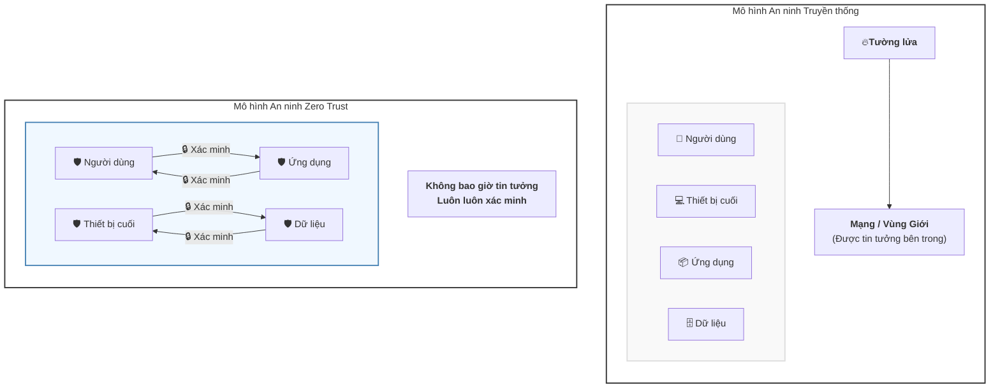
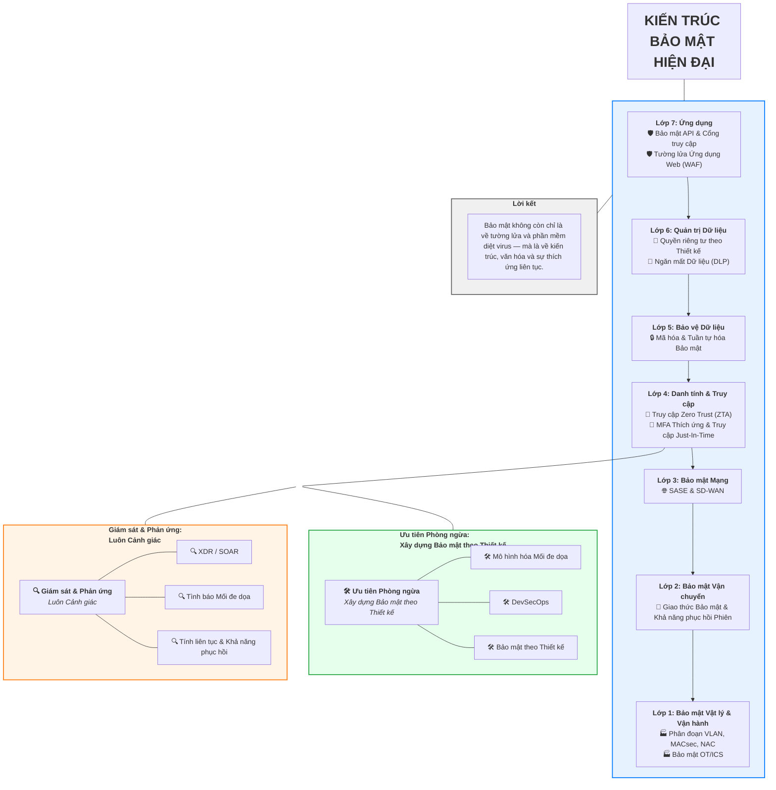

# Phần 1. An ninh mạng không còn là một lựa chọn, nó là một nhu cầu:

Trong bối cảnh cảnh quan kỹ thuật số ngày càng phát triển, các mối đe dọa an ninh mạng cũng trở nên tinh vi hơn. Cách tiếp cận an ninh truyền thống, vốn tập trung vào việc xây dựng một bức tường phòng thủ xung quanh mạng, không còn đủ hiệu quả.

Đây là lúc mô hình **Zero Trust** ra đời. Zero Trust là một mô hình an ninh chủ động, không bị động, hoạt động dựa trên nguyên tắc "không bao giờ tin tưởng, luôn luôn xác minh". Nó giả định rằng có sự xâm nhập và xác minh từng yêu cầu truy cập, bất kể nó đến từ đâu.

**Các nguyên tắc cốt lõi của Zero Trust bao gồm:**

✅ Quyền truy cập tối thiểu

✅ Phân đoạn vi mô

✅ Giám sát liên tục

Bằng cách áp dụng Zero Trust, các tổ chức có thể giảm đáng kể bề mặt tấn công của mình và cải thiện đáng kể tư thế an ninh tổng thể.

Đã đến lúc chuyển từ tư duy "giả định an toàn" sang "giả định có sự xâm nhập". Đầu tư vào Zero Trust không chỉ là một quyết định chiến lược mà còn là một yêu cầu kinh doanh.

#Cybersecurity #ZeroTrust #DevSecOps

---

### **Sơ đồ Mermaid (Dạng đồ thị TD)**

Dưới đây là sơ đồ Mermaid được chuyển đổi từ hình ảnh trong bài viết, mô tả sự khác biệt giữa **Mô hình An ninh Truyền thống** và **Mô hình An ninh Zero Trust**. Toàn bộ văn bản trong sơ đồ đều bằng tiếng Việt.

 

Bạn có thể sao chép mã này và dán vào bất kỳ trình chỉnh sửa hỗ trợ Mermaid nào (như draw.io, VS Code với extension Mermaid, hoặc các công cụ trực tuyến) để hiển thị sơ đồ.

**Giải thích sơ đồ:**

*   **Mô hình Truyền thống:** Mọi thứ được bảo vệ bởi một "Vùng Giới" (Perimeter) duy nhất (như tường lửa). Một khi đã ở bên trong, người dùng và thiết bị thường được tin tưởng và có thể di chuyển tự do.
*   **Mô hình Zero Trust:** Không có vùng giới tin cậy. Mỗi thành phần (người dùng, thiết bị, ứng dụng, dữ liệu) đều được bảo vệ riêng lẻ (biểu tượng 🛡️). Mọi tương tác và truy cập giữa chúng đều phải được xác minh (biểu tượng 🔒), dù cho chúng đến từ bên trong hay bên ngoài mạng.

---

# Phần 2. Kiến trúc Bảo mật Hiện đại: Một Cách tiếp cận Phân lớp đối với Kiến trúc Bảo mật Hiện đại

Trong thế giới siêu kết nối ngày nay, an ninh mạng không còn là vấn đề của riêng bộ phận IT mà đã trở thành một mệnh lệnh chiến lược. Khi chuyển đổi số tăng tốc, các tổ chức phải áp dụng một kiến trúc bảo mật toàn diện, phân lớp, không chỉ phòng thủ mà còn dự đoán, thích ứng và phát triển.

Khung "Kiến trúc Bảo mật Hiện đại" cung cấp một bản thiết kế mạnh mẽ để xây dựng các hệ sinh thái kỹ thuật số linh hoạt. Hãy cùng phân tích nó:

**Phòng thủ Phân lớp: Từ API đến Cơ sở hạ tầng**
Mỗi lớp trong kiến trúc này giải quyết một lĩnh vực rủi ro cụ thể, tạo ra một lớp khiên đa chiều:

**Lớp 7: Lớp Ứng dụng**
*   **Bảo mật API & Cổng truy cập:** Bảo vệ việc trao đổi dữ liệu giữa các dịch vụ.
*   **Tường lửa Ứng dụng Web (WAF):** Phòng thủ chống lại các cuộc tấn công web phổ biến.

**Lớp 6: Quản trị Dữ liệu**
*   **Quyền riêng tư theo Thiết kế:** Nhúng sự tuân thủ vào kiến trúc hệ thống.
*   **Ngăn mất Dữ liệu (DLP):** Ngăn chặn việc rò rỉ dữ liệu trái phép.

**Lớp 5: Bảo vệ Dữ liệu**
*   **Mã hóa & Tuần tự hóa Bảo mật:** Đảm bảo tính toàn vẹn và bảo mật của dữ liệu.

**Lớp 4: Danh tính & Truy cập**
*   **Truy cập Zero Trust (ZTA):** Không tin tưởng bất kỳ ai, xác minh mọi thứ.
*   **MFA Thích ứng & Truy cập Just-In-Time:** Xác thực động dựa trên ngữ cảnh.

**Lớp 3: Bảo mật Mạng**
*   **SASE & SD-WAN:** Dịch vụ truy cập an toàn cho các môi trường ưu tiên đám mây.

**Lớp 2: Bảo mật Vận chuyển**
*   **Giao thức Bảo mật & Khả năng phục hồi Phiên làm việc:** Củng cố dữ liệu đang truyền.

**Lớp 1: Bảo mật Vật lý & Vận hành**
*   **Phân đoạn VLAN, MACsec, NAC:** Kiểm soát truy cập ở tầng liên kết dữ liệu.
*   **Bảo mật OT/ICS:** Bảo vệ các hệ thống cơ sở hạ tầng quan trọng.

**Ưu tiên Phòng ngừa: Xây dựng Bảo mật theo Thiết kế**
Bảo mật phải được "dịch chuyển sang trái" (shift-left) — tích hợp sớm trong vòng đời phát triển:
*   **Mô hình hóa Mối đe dọa:** Xác định các lỗ hổng trước khi chúng biểu hiện.
*   **DevSecOps:** Nhúng bảo mật vào các pipeline CI/CD.
*   **Bảo mật theo Thiết kế:** Kiến trúc hệ thống với bảo mật là nguyên tắc nền tảng.

**Giám sát & Phản ứng: Luôn Cảnh giác**
Khả năng phát hiện và phản ứng là xương sống của sự linh hoạt:
*   **XDR / SOAR:** Phát hiện mối đe dọa thống nhất và phản hồi tự động.
*   **Tình báo Mối đe dọa:** Thông tin theo thời gian thực về các mối đe dọa mới nổi.
*   **Tính liên tục & Khả năng phục hồi:** Đảm bảo hoạt động kinh doanh chịu được sự gián đoạn.

**Lời kết:**
Bảo mật không còn chỉ là về tường lửa và phần mềm diệt virus — mà là về kiến trúc, văn hóa và sự thích ứng liên tục. Dù bạn là CTO, CISO hay nhà chiến lược doanh nghiệp, việc áp dụng mô hình phân lớp này có thể giúp tổ chức của bạn đối phó với các mối đe dọa đang tiến hóa trong tương lai.
Hãy cùng xây dựng các hệ thống an toàn, linh hoạt — từng lớp một.

#CyberSecurity #ZeroTrust #DevSecOps #SecurityArchitecture #DigitalTransformation #EnterpriseSecurity #TechLeadership

---

### **Sơ đồ Mermaid (Dạng đồ thị TD)**

Dưới đây là mã Mermaid để vẽ lại sơ đồ từ hình ảnh, với toàn bộ văn bản đã được dịch sang tiếng Việt. Bạn có thể sao chép và dán mã này vào bất kỳ trình chỉnh sửa hỗ trợ Mermaid nào (như draw.io, Mermaid Live Editor, v.v.) để hiển thị sơ đồ.

