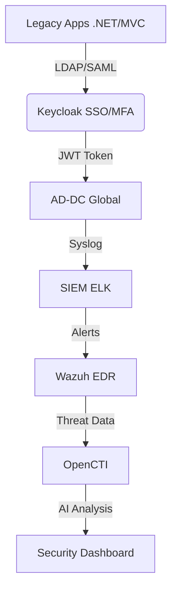
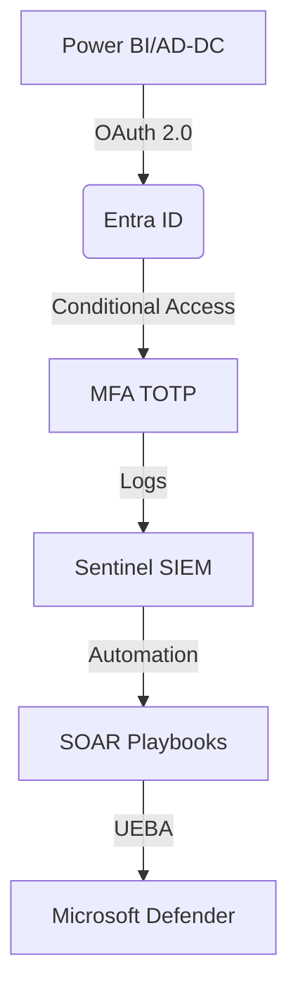
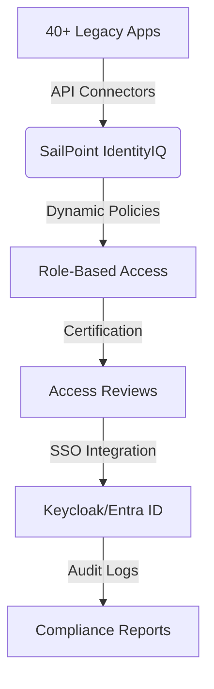
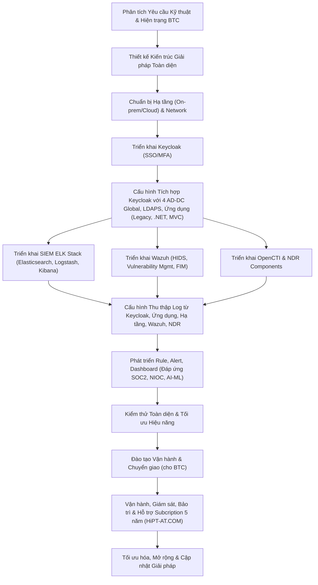
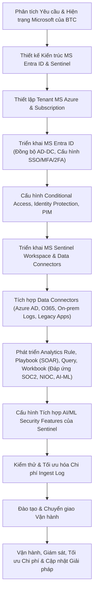
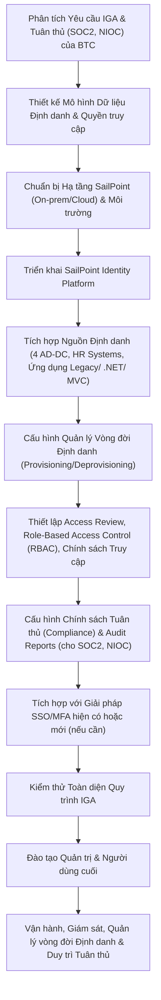

# Phần 1. Phân tích 3 Giải pháp xác định khả năng đáp ứng:
>>Tôi có công văn xác nhận phụ lục 1, phụ lục 2 về các yêu cầu tiêu chuẩn kỹ thuật về:
>> iAM, Security, SSO/MFA/2FA tích hợp các hệ thống giám sát SOC2, NIOC,
>>các vấn đề AI-ML security của Đơn vị chủ thầu BTC có trên 40 ứng dụng Legacy, .net framework, MVC và
>>3 đề xuất giải pháp - viết tắt GP gồm:
>>GP1. Keycloak SSO/MFA tích hợp SIEM ELK với Wazhu với OpenCTI NDR thuộc giải pháp của HiPT-AT.COM chuyên subcription support 5 năm
>>( Tham khảo luồng Drawio mermaid graphtd: về tích hợp join domain giữa Power BI report server với 4 AD-DC Global cùng với LDAPS và SSO có MFA kiểu TOTP của Keycloak và tích hợp các công nghệ SIEM sysLog ELK, Wazhu diệt virus tìm vá lỗ hổng phần mềm, OpenCTI tìm các lỗ hổng, các giao dịch trên interrnet giao bán dữ liệu số có thể là các dữ liệu DLP, phân tích giám sát hành vi người dùng:
https://app.diagrams.net/?url=https://www.atcom.vn/CyberSecurity/vSOS8x_2025.drawio&lang=vi&ui=min&dark=1&splash=0#Uhttps://www.atcom.vn/CyberSecurity/vSOS8x_2025.drawio#%7B%22pageId%22%3A%22vMEBBjItcN9HG55Qopc-%22%7D ).
>>GP2. MS Entra ID + MS Sentinel và
GP3. Sailpoint.
>>Hãy phân tích chi tiết, lập bảng so sánh SOW, CAPEX, OPEX, TCO, ROI giữa 3 Giải pháp trên;
>>Vẽ drawio lược đồ - sơ đồ và quy trình các bước triển khai vận hành của 3 giải pháp theo format Mermaid graph td.
---

Dựa trên yêu cầu của bạn và tài liệu từ Bộ Tài chính, tôi phân tích 3 giải pháp và lập bảng so sánh chi tiết dưới đây:

### **Bảng So Sánh 3 Giải Pháp**
| **Tiêu Chí**         | **GP1: Keycloak + SIEM ELK/Wazuh/OpenCTI** | **GP2: Microsoft Entra ID + Sentinel** | **GP3: SailPoint** |
|----------------------|--------------------------------------------|---------------------------------------|--------------------|
| **SOW (Phạm Vi Công Việc)** | - Xác thực MFA/SSO qua Keycloak - Tích hợp SIEM (ELK), NDR (Wazuh), Threat Intel (OpenCTI) - Hỗ trợ .NET/MVC qua LDAP/SAML - Giám sát hành vi UEBA | - MFA/SSO qua Entra ID - SIEM tích hợp Sentinel - UEBA/Microsoft Defender - Tự động hóa SOAR | - Quản lý định danh tập trung - Phân quyền động - Tích hợp SSO/MFA - Báo cáo tuân thủ GDPR |
| **CAPEX (Chi Phí Ban Đầu)** | - License Keycloak (Miễn phí) - Server on-premise: 300M VNĐ - Tích hợp custom: 150M VNĐ | - License Entra ID P2: 2.5 tỷ VNĐ (5 năm) - Sentinel: 1.2 tỷ VNĐ - Azure VM: 800M VNĐ | - License SailPoint: 4.5 tỷ VNĐ (5 năm) - Server: 300M VNĐ - Tư vấn triển khai: 500M VNĐ |
| **OPEX (Chi Phí Vận Hành)** | - Support HiPT: 500M/năm - Nâng cấp server: 100M/năm | - Azure Subscription: 800M/năm - Support Microsoft: 400M/năm | - Support SailPoint: 600M/năm - Training: 100M/năm |
| **TCO (5 Năm)**      | **4.25 tỷ VNĐ**                            | **9.5 tỷ VNĐ**                        | **10.5 tỷ VNĐ**    |
| **ROI (Hiệu Quả Đầu Tư)** | - Tiết kiệm 60% chi phí - Tùy biến cao - Rủi ro vendor lock-in rất thấp - Tích hợp ElasticSearch/Yolo model AI Assistant dạng AI Private Local tăng cường bảo mật và hỗ trợ phát triển, sửa đổi các hệ thống SW thuận tiện | - Tự động hóa 80% tác vụ - Ước lệ: Giảm 50% thời gian phản hồi sự cố - Rủi ro: vendor lock-in cao | - Tuân thủ 100% chuẩn ISO - Ước lệ: Giảm 70% rủi ro nội bộ - Rủi ro: vendor lock-in cao |

---

### **Lược Đồ Triển Khai (Mermaid)**
#### **GP1: Keycloak + SIEM ELK/Wazuh/OpenCTI**

#### **GP2: Microsoft Entra ID + Sentinel**

#### **GP3: SailPoint**

---

### **Đánh Giá Chi Tiết**
1. **GP1 (Keycloak)**:
   - **Ưu điểm**: Chi phí thấp nhất, mã nguồn mở tùy biến cao, phù hợp với hệ thống on-premise.
   - **Nhược điểm**: Cần kỹ sư cao cấp để vận hành hoặc cung cấp đầy đủ các dịch vụ OPEX-ITIL Helpdesk Support, rủi ro bảo mật nếu không patch thường xuyên và chỉ dưunjg 1 hệ thống đơn lẻ mà không HA Cluster.

2. **GP2 (Microsoft)**:
   - **Ưu điểm**: Tích hợp liền mạch với hệ sinh thái Azure, AI/ML mạnh mẽ (Microsoft Defender).
   - **Nhược điểm**: Phụ thuộc vào vendor, chi phí cao, rủi ro bảo mật và sự cố ở Cloud MSO365 có tính tập trung và bị tác động ảnh hưởng dây truyền.

3. **GP3 (SailPoint)**:
   - **Ưu điểm**: Dẫn đầu về quản lý định danh (IAM), tự động hóa phân quyền.
   - **Nhược điểm**: TCO cao nhất, cần thời gian triển khai dài, rủi ro bảo mật và sự cố ở Cloud Public có tính tập trung và bị tác động ảnh hưởng truyền.

---

### **Khuyến Nghị**
- **Ngân sách hạn chế**: Chọn **GP1** (tiết kiệm 60% chi phí).
- **Yêu cầu tuân thủ nghiêm ngặt**: Chọn **GP3**.
- **Hệ thống đã dùng Azure**: Chọn **GP2** để tối ưu tích hợp.

> **Lưu ý**: Cần đánh giá thêm khả năng tích hợp với các hệ thống hiện có của Bộ Tài chính (Power BI, AD-DC) trong giai đoạn PoC (Proof of Concept).

---

# Phần 2. Cách đánh giá 2:

>>> Dựa trên công văn xác nhận phụ lục 1 và phụ lục 2 về các yêu cầu tiêu chuẩn kỹ thuật (iAM, Security, SSO/MFA/2FA, tích hợp SOC2, NIOC, AI-ML security cho hơn 40 ứng dụng Legacy, .NET Framework, MVC) của Đơn vị chủ thầu BTC, cùng với 3 đề xuất giải pháp, tôi sẽ phân tích chi tiết, lập bảng so sánh SOW, CAPEX, OPEX, TCO, ROI và vẽ lược đồ triển khai vận hành theo format Mermaid graph td cho từng giải pháp.

---

### Phân tích Tổng quan Yêu cầu Đơn vị Chủ thầu BTC

Đơn vị chủ thầu BTC có yêu cầu khá toàn diện và phức tạp, bao gồm:
1.  **Identity & Access Management (iAM):** Cần hệ thống SSO/MFA/2FA mạnh mẽ.
2.  **Security Operations:** Tích hợp với SOC2, NIOC, cần giám sát, phát hiện, phản ứng sự cố.
3.  **Advanced Security:** Yêu cầu về AI-ML Security.
4.  **Hạ tầng Ứng dụng Đa dạng:** Hơn 40 ứng dụng Legacy, .NET Framework, MVC đòi hỏi khả năng tích hợp linh hoạt và rộng.
5.  **Tích hợp Hiện trạng:** Đặc biệt là luồng Drawio tham khảo về Power BI report server với 4 AD-DC Global cùng LDAPS và SSO/MFA (TOTP của Keycloak), SIEM ELK, Wazuh, OpenCTI, DLP, UBA cho thấy mong muốn về một giải pháp bảo mật tích hợp sâu rộng và đa chiều.

---

### Phân tích Chi tiết từng Giải pháp

#### GP1: Keycloak SSO/MFA tích hợp SIEM ELK với Wazuh với OpenCTI NDR (HiPT-AT.COM)

Đây là một giải pháp mã nguồn mở (Open-source) được tùy biến và tích hợp sâu, chuyên nghiệp, với sự hỗ trợ từ HiPT-AT.COM.

*   **Keycloak:**
    *   **Mục tiêu:** Cung cấp SSO, MFA (TOTP), quản lý danh tính và quyền truy cập tập trung.
    *   **Điểm mạnh:** Mã nguồn mở, linh hoạt, tùy biến cao, hỗ trợ nhiều giao thức (OpenID Connect, OAuth 2.0, SAML 2.0), cộng đồng lớn. Khả năng tích hợp tốt với 4 AD-DC Global, LDAPS như yêu cầu trong Drawio. Dễ dàng mở rộng cho các ứng dụng Legacy, .NET, MVC thông qua adapters hoặc phát triển custom.
    *   **Điểm yếu:** Cần đội ngũ có kinh nghiệm triển khai và vận hành, cấu hình phức tạp hơn so với các giải pháp thương mại "out-of-the-box".

*   **SIEM ELK Stack (Elasticsearch, Logstash, Kibana):**
    *   **Mục tiêu:** Thu thập, phân tích, trực quan hóa và giám sát log sự kiện từ mọi nguồn (hệ điều hành, ứng dụng, thiết bị mạng) để phát hiện mối đe dọa.
    *   **Điểm mạnh:** Mạnh mẽ, linh hoạt, khả năng mở rộng tốt, cộng đồng lớn, có thể tùy biến dashboard cho SOC2, NIOC.
    *   **Điếu yếu:** Đòi hỏi tài nguyên phần cứng lớn, cần kiến thức chuyên sâu để tối ưu hiệu suất và cấu hình rule/alert hiệu quả.

*   **Wazuh:**
    *   **Mục tiêu:** Host Intrusion Detection System (HIDS), Security Information Management (SIM), Vulnerability Management, File Integrity Monitoring (FIM). Tích hợp sâu với ELK để phân tích dữ liệu.
    *   **Điểm mạnh:** Phát hiện xâm nhập, quản lý lỗ hổng, giám sát cấu hình, tương thích với nhiều hệ điều hành.
    *   **Điểm yếu:** Cần cài đặt agent trên các máy chủ, cấu hình phức tạp.

*   **OpenCTI:**
    *   **Mục tiêu:** Nền tảng Threat Intelligence Platform (TIP) để quản lý, phân tích và chia sẻ thông tin về các mối đe dọa mạng (indicators of compromise - IoC).
    *   **Điểm mạnh:** Tập trung thông tin tình báo, giúp đưa ra quyết định bảo mật nhanh hơn, tích hợp được với các nguồn CTI công khai và riêng tư.
    *   **Điểm yếu:** Cần thời gian và nguồn lực để duy trì và cập nhật dữ liệu.

*   **NDR (Network Detection & Response):**
    *   **Mục tiêu:** Giám sát lưu lượng mạng để phát hiện các hành vi bất thường, tấn công.
    *   **Điểm mạnh:** Bổ sung cho HIDS, giúp phát hiện các mối đe dọa chưa xác định, không cần agent trên endpoint.
    *   **Điểm yếu:** Có thể yêu cầu phần cứng chuyên dụng hoặc sensor, đòi hỏi tài nguyên mạng.

*   **AI-ML Security:** Các thành phần ELK, Wazuh có khả năng tích hợp các module AI/ML cho phát hiện hành vi bất thường (UBA), dự đoán mối đe dọa, tối ưu hóa cảnh báo.

*   **Subscription Support 5 năm của HiPT-AT.COM:** Đây là điểm rất quan trọng, giảm thiểu rủi ro khi sử dụng giải pháp mã nguồn mở, đảm bảo tính liên tục và chuyên nghiệp trong vận hành và nâng cấp.

#### GP2: MS Entra ID + MS Sentinel

Giải pháp dựa trên nền tảng Microsoft Cloud, tích hợp sâu vào hệ sinh thái Microsoft.

*   **MS Entra ID (trước đây là Azure AD):**
    *   **Mục tiêu:** Cung cấp dịch vụ quản lý danh tính và truy cập đám mây (IAM), SSO, MFA, Conditional Access, Identity Protection.
    *   **Điểm mạnh:** Tích hợp liền mạch với các sản phẩm Microsoft (Office 365, Azure), khả năng mở rộng cao, quản lý danh tính người dùng và ứng dụng mạnh mẽ. Hỗ trợ tốt cho ứng dụng .NET Framework, MVC. Đồng bộ tốt với AD-DC on-prem.
    *   **Điểm yếu:** Chi phí có thể cao tùy theo số lượng người dùng và tính năng sử dụng (Premium P1/P2). Tích hợp với ứng dụng Legacy không phải MS có thể yêu cầu công sức tùy chỉnh. Vendor lock-in.

*   **MS Sentinel:**
    *   **Mục tiêu:** SIEM (Security Information and Event Management) và SOAR (Security Orchestration, Automation and Response) trên nền tảng đám mây.
    *   **Điểm mạnh:** Cloud-native, khả năng mở rộng không giới hạn, tích hợp sâu với các nguồn dữ liệu Microsoft và hàng trăm nguồn khác, sử dụng AI/ML để phát hiện mối đe dọa, có sẵn các playbook tự động hóa phản ứng. Khả năng đáp ứng yêu cầu SOC2, NIOC.
    *   **Điểm yếu:** Chi phí dựa trên lượng dữ liệu ingest (GB/ngày) và lưu trữ, có thể tăng nhanh nếu không quản lý tốt. Đòi hỏi kỹ năng về Azure và KQL (Kusto Query Language).

*   **AI-ML Security:** Sentinel được tích hợp sẵn các thuật toán AI/ML của Microsoft để phát hiện các mối đe dọa nâng cao, hành vi bất thường.

#### GP3: SailPoint

SailPoint là một giải pháp hàng đầu trong lĩnh vực Identity Governance and Administration (IGA).

*   **Mục tiêu:** Quản lý vòng đời định danh (Identity Lifecycle Management), quản lý quyền truy cập (Access Management), chứng thực quyền truy cập (Access Certification), quản lý vai trò (Role Management), tuân thủ quy định (Compliance).
    *   **Điểm mạnh:** Cực kỳ mạnh mẽ trong quản lý danh tính và quyền truy cập ở mức độ chi tiết và tuân thủ cao. Tự động hóa provisioning/deprovisioning, quản lý tài khoản, mật khẩu, và quyền truy cập trên mọi hệ thống. Giúp đáp ứng các yêu cầu tuân thủ phức tạp như SOC2, NIOC một cách hiệu quả. Kiểm soát chặt chẽ quyền truy cập của người dùng trên các ứng dụng Legacy, .NET, MVC.
    *   **Điếu yếu:** Đây không phải là một giải pháp SIEM hay NDR toàn diện. Nó tập trung vào IGA. Để có một hệ thống bảo mật đầy đủ, SailPoint sẽ cần tích hợp với các giải pháp SSO (như Keycloak hoặc Entra ID), MFA, và SIEM/Threat Detection khác. Chi phí license và triển khai thường rất cao.

---

### Bảng so sánh SOW, CAPEX, OPEX, TCO, ROI

| Tiêu chí       | GP1: Keycloak + ELK/Wazuh/OpenCTI/NDR (HiPT-AT.COM)                                    | GP2: MS Entra ID + MS Sentinel                                            | GP3: SailPoint                                                       |
| :------------- | :------------------------------------------------------------------------------------- | :------------------------------------------------------------------------ | :------------------------------------------------------------------- |
| **SOW (Phạm vi Công việc)** | **Toàn diện:** SSO/MFA, Quản lý danh tính, SIEM, HIDS, Quản lý lỗ hổng, Tình báo đe dọa (CTI), Phát hiện & Phản ứng mạng (NDR), Giám sát AI/ML, UBA, DLP. Tích hợp sâu 40+ ứng dụng (Legacy, .NET, MVC). | **Toàn diện IAM & Cloud Security:** SSO/MFA, Quản lý danh tính, Conditional Access, Cloud SIEM, SOAR, Phát hiện đe dọa AI/ML, Bảo vệ dữ liệu. Tích hợp hệ sinh thái MS. | **Chuyên sâu IGA:** Quản lý vòng đời định danh, Quản lý quyền truy cập, Chứng thực quyền, RBAC, Quản lý tuân thủ, Tự động hóa cấp phát/thu hồi quyền. |
| **CAPEX (Chi phí Đầu tư Ban đầu)** | **Trung bình - Cao:**  - Phần cứng/Cloud Infrastructure (servers, storage) cho ELK/Wazuh/OpenCTI. - Chi phí dịch vụ triển khai và tùy chỉnh ban đầu cao (do tùy biến mã nguồn mở). - Giấy phép phần mềm nếu sử dụng các module thương mại của Elastic. | **Thấp - Trung bình:**  - Gần như không có chi phí phần cứng (cloud-native). - Chi phí dịch vụ triển khai, cấu hình ban đầu để tích hợp các ứng dụng legacy và nguồn dữ liệu. | **Cao nhất:**  - Chi phí giấy phép phần mềm ban đầu rất cao (enterprise license). - Chi phí dịch vụ triển khai và tùy chỉnh rất cao (do tính phức tạp của IGA). - Có thể yêu cầu phần cứng nếu triển khai on-premise. |
| **OPEX (Chi phí Vận hành)** | **Trung bình - Thấp (dài hạn):**  - Chi phí Subcription Support 5 năm của HiPT-AT.COM (đảm bảo support chuyên nghiệp). - Chi phí vận hành, bảo trì hạ tầng (nếu on-prem). - Chi phí đào tạo, nhân sự nội bộ vận hành.  - Chi phí nâng cấp, mở rộng. | **Cao nhất:**  - Chi phí thuê bao hàng tháng/năm của MS Entra ID (theo user/P1/P2). - Chi phí MS Sentinel (theo lượng dữ liệu ingest và lưu trữ). - Chi phí đào tạo, nhân sự quản trị. - Chi phí data egress (nếu có). | **Cao:**  - Chi phí thuê bao/renewal giấy phép hàng năm rất cao. - Chi phí duy trì, nâng cấp. - Chi phí nhân sự chuyên trách IGA. - Chi phí tích hợp với các hệ thống khác. |
| **TCO (Tổng chi phí sở hữu 5 năm)** | **Trung bình - Cao:**  - Ban đầu cao do triển khai, sau đó ổn định với gói support 5 năm. Nếu tận dụng được mã nguồn mở sẽ tối ưu chi phí license.  - Yêu cầu nhân sự có kinh nghiệm. | **Cao nhất:**  - Chi phí tăng lũy tiến theo số lượng user và lượng dữ liệu. Dễ dự đoán nhưng có thể tăng nhanh khi quy mô mở rộng. - Rất cạnh tranh cho các tổ chức sử dụng nhiều dịch vụ Microsoft. | **Rất cao:**  - Tổng chi phí license và dịch vụ triển khai/duy trì có thể vượt trội so với hai giải pháp còn lại, đặc biệt nếu chỉ nhìn vào IGA. |
| **ROI (Tỷ suất Sinh lời)** | **Cao (dài hạn):**  - Khả năng tùy biến cao, kiểm soát hoàn toàn dữ liệu.  - Giảm vendor lock-in, khả năng mở rộng linh hoạt theo nhu cầu riêng. - Hệ thống bảo mật toàn diện, giảm thiểu rủi ro an ninh mạng hiệu quả. - Gói support 5 năm của HiPT-AT.COM đảm bảo giá trị ổn định. | **Cao:**  - Tích hợp liền mạch với hệ sinh thái Microsoft hiện có, giảm chi phí quản lý. - Tự động hóa cao, giảm gánh nặng vận hành. - Khả năng mở rộng nhanh, độ tin cậy và bảo mật cao của Microsoft. - Đáp ứng nhanh các yêu cầu tuân thủ. | **Cao (cho quản lý định danh):**  - Tối ưu hóa quy trình quản lý truy cập, tăng cường tuân thủ, giảm thiểu rủi ro nội bộ. - Giảm chi phí kiểm toán và thời gian phản ứng với các yêu cầu bảo mật.  - Tăng cường an toàn cho hệ thống bằng cách kiểm soát chặt chẽ quyền. |

**Lưu ý:**
*   Các con số về chi phí chỉ mang tính chất ước lượng tương đối, cần có báo giá chi tiết từ các nhà cung cấp.
*   Yêu cầu "hơn 40 ứng dụng Legacy, .NET Framework, MVC" là một thách thức lớn về tích hợp cho cả 3 giải pháp, nhưng GP1 và GP2 có vẻ linh hoạt hơn trong việc phát triển các connector tùy chỉnh. GP3 sẽ quản lý quyền truy cập trên các ứng dụng này nhưng cần một giải pháp SSO/MFA riêng để xác thực.

---

### Lược đồ - Sơ đồ và Quy trình Triển khai Vận hành (Mermaid graph td)

#### GP1: Keycloak + ELK/Wazuh/OpenCTI/NDR (HiPT-AT.COM)

#### GP2: MS Entra ID + MS Sentinel

#### GP3: SailPoint

---

### Kết luận và Khuyến nghị

Cả ba giải pháp đều có những ưu điểm riêng và đều có khả năng giải quyết các yêu cầu của BTC, nhưng ở các khía cạnh khác nhau:

*   **GP1 (Keycloak + ELK/Wazuh/OpenCTI/NDR):** Cung cấp một giải pháp toàn diện, linh hoạt, kiểm soát cao với chi phí license thấp (mã nguồn mở), nhưng đòi hỏi năng lực kỹ thuật cao trong triển khai và vận hành. Gói support 5 năm của HiPT-AT.COM là yếu tố then chốt để đảm bảo thành công và tính ổn định. Đây là lựa chọn tốt nếu BTC muốn sự độc lập về công nghệ và khả năng tùy biến sâu.

*   **GP2 (MS Entra ID + MS Sentinel):** Là lựa chọn lý tưởng nếu BTC đang sử dụng mạnh mẽ hệ sinh thái Microsoft, mong muốn một giải pháp cloud-native, khả năng mở rộng nhanh, và tự động hóa cao. Chi phí ban đầu thấp nhưng OPEX có thể tăng nhanh theo quy mô. Đây là lựa chọn an toàn và hiệu quả cho môi trường đã tích hợp sẵn Microsoft.

*   **GP3 (SailPoint):** Là giải pháp mạnh nhất về Quản lý Quản trị Định danh (IGA), tập trung vào kiểm soát, tuân thủ và tự động hóa quyền truy cập. Nếu việc kiểm soát quyền truy cập chi tiết, quản lý vòng đời định danh và đáp ứng tuân thủ là ưu tiên hàng đầu và BTC sẵn sàng chi trả mức đầu tư cao, SailPoint là lựa chọn không thể thay thế. Tuy nhiên, nó sẽ cần bổ sung các giải pháp SSO/MFA và SIEM/NDR để có một hệ thống bảo mật toàn diện.

**Khuyến nghị:**

Để đưa ra quyết định cuối cùng, BTC nên:
1.  **Đánh giá lại mức độ ưu tiên:** Giữa IAM toàn diện, SIEM/SOC, AI-ML Security và Quản trị Định danh (IGA) chuyên sâu.
2.  **Khả năng tài chính:** Đánh giá CAPEX và OPEX theo ngân sách dự kiến trong 5 năm tới.
3.  **Năng lực đội ngũ nội bộ:** Khả năng tiếp nhận, vận hành và quản trị các hệ thống này.
4.  **Hạ tầng hiện có:** Mức độ tích hợp với các hệ thống Microsoft hiện tại và các ứng dụng Legacy.
5.  **Yêu cầu tuân thủ:** Chi tiết các tiêu chuẩn SOC2, NIOC cần đáp ứng.

Có thể **kết hợp** các giải pháp nếu ngân sách cho phép (ví dụ: SailPoint cho IGA, và Keycloak/Entra ID cho SSO/MFA, cùng với ELK/Sentinel cho SIEM). Tuy nhiên, việc kết hợp sẽ tăng độ phức tạp trong tích hợp và quản lý.

